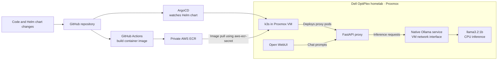
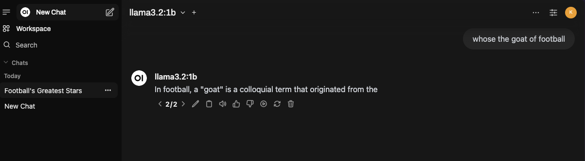
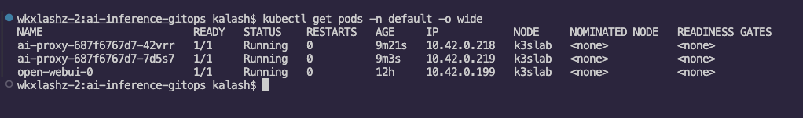
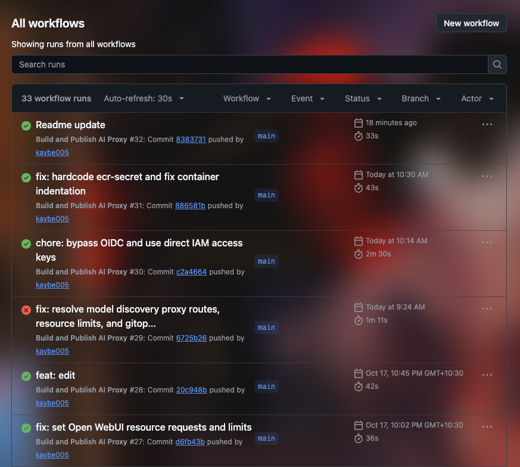

# Self-Hosted GitOps AI Inference Platform

A local AI inference stack on a CPU-only Proxmox homelab, with GitHub Actions providing cloud-based image builds and ArgoCD managing Kubernetes deployments. The deployment uses rolling updates and health checks to support zero-downtime releases while keeping model inference on-premises.

The platform runs on a Dell OptiPlex server. A Proxmox VM hosts a `k3s` cluster and a native Ollama service; Open WebUI provides the chat interface, and a custom FastAPI proxy connects it to the local model.

## Architecture

GitHub Actions builds and publishes the FastAPI image to ECR. ArgoCD watches the repository’s Helm chart and reconciles the `k3s` cluster. Open WebUI sends chat prompts through the proxy to Ollama, which runs locally on the VM.

## Core Technologies

| Category       | Technologies                                                   |
| -------------- | -------------------------------------------------------------- |
| Infrastructure | Dell OptiPlex homelab, Proxmox, local `k3s` Kubernetes cluster |
| CI/CD          | GitHub Actions, ArgoCD, private AWS ECR                        |
| Application    | FastAPI Python proxy, Open WebUI                               |
| AI             | Native Ollama service, Meta `llama3.2:1b`, CPU inference       |

## Key Engineering Highlights & Problem Solving

### ECR authentication under AWS Organizations SCP restrictions

AWS Organizations Service Control Policy (SCP) restrictions blocked the standard GitHub Actions OIDC federation path. The deployment switched to static AWS IAM credentials, securely injected into Kubernetes secrets and used by the configured `aws-ecr-secret`. This resolved `403 Forbidden` errors when `k3s` pulled images from private ECR.

### Ollama network binding and readiness checks

Kubernetes readiness probes initially returned `503` because Ollama’s systemd service listened only on `127.0.0.1`. Reconfiguring Ollama to listen on `0.0.0.0` made it reachable over the VM network from the cluster. The proxy’s `/readyz` probe checks that Ollama is reachable and the model is loaded before the pod accepts traffic; `/healthz` provides a health check.

### Model selection for CPU-only inference

The initial `llama3.2:3b` deployment was bottlenecked by CPU inference, reaching approximately 15 seconds per word. A GitOps configuration rollout changed the model to `llama3.2:1b`, enabling functional, low-latency streaming inference on the available CPU-only hardware.

## System Demonstration

### Open WebUI Inference

### Kubernetes Cluster State

### Github Actions CI Pipeline

## Deployment & Workflow

1. A FastAPI proxy change is pushed to the GitHub repository.
2. GitHub Actions builds the container image and pushes it to the private AWS ECR repository.
3. ArgoCD continuously monitors the repository for Helm chart updates.
4. When chart changes are available, ArgoCD syncs the desired state to the `k3s` cluster in the Proxmox VM.
5. Kubernetes pulls the proxy image from ECR using the configured `aws-ecr-secret` and deploys the updated pods.
6. A rolling update with `maxSurge: 1` starts replacement capacity while `/healthz` and `/readyz` probes check pod health and Ollama readiness.
7. Open WebUI routes chat prompts through the FastAPI proxy to the native Ollama service and `llama3.2:1b` model.

## Future Improvements

- Migrate from static AWS IAM credentials to GitHub Actions OIDC federation when AWS Organizations SCP restrictions allow it.
- Add Prometheus and Grafana for observability.
- Implement GPU PCIe passthrough to accelerate inference.
